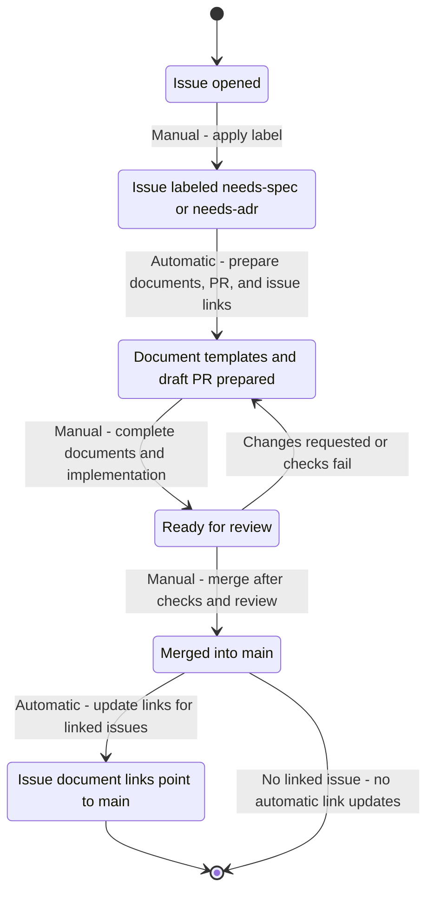

# Development process

This repository follows the [shared SDLC development process](https://github.com/qubernetes-dev/sdlc-action/blob/main/docs/development-process.md), which describes the issue-to-merge workflow and includes the Mermaid process diagram.

Apply `needs-spec` or `needs-adr` to an issue to prepare document templates and a draft PR. Specifications live in [`doc/specs/`](specs/) and architecture decisions in [`doc/adrs/`](adrs/). Complete the documents, implement the change, and verify it before review and merge.

Follow [CONTRIBUTING.md](../CONTRIBUTING.md) for q8s development setup, package layout, tests, code checks, and PR guidelines. Follow the [publishing instructions](../README.md#publishing-packages) when releasing packages.

The [scaffolding workflow](../.github/workflows/scaffold-issue-docs.yml) and [merge-link workflow](../.github/workflows/update-merged-doc-links.yml) call the shared action. Keep both pinned to the same reviewed action commit when upgrading.
