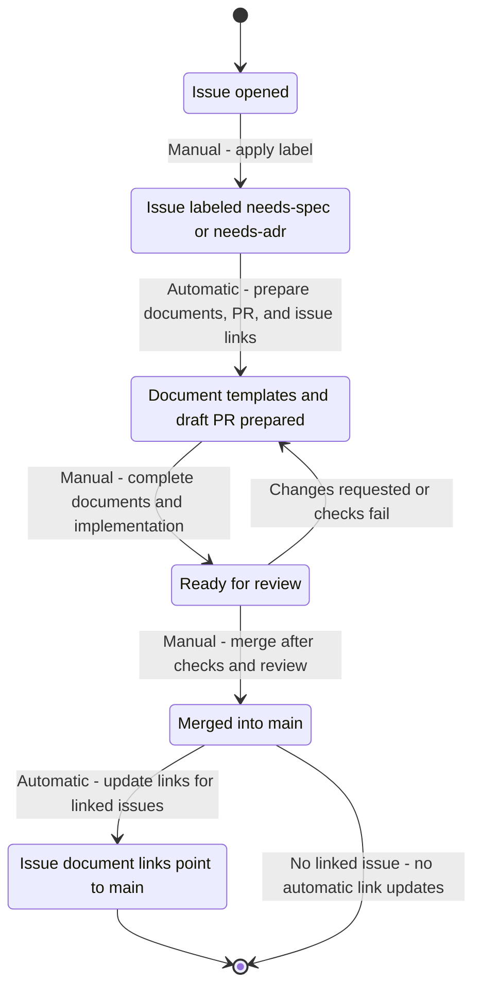

# Development process

Development connects a reported problem to specified behavior, implementation, verification, and release. Issues capture the problem, feature specifications describe observable behavior, and Architecture Decision Records (ADRs) explain significant design choices. Pull requests bring the code, tests, and related documentation together for review.

Use [CONTRIBUTING.md](../CONTRIBUTING.md) for environment setup, package layout, test commands, code checks, and submission guidelines. This document describes how those activities fit together. The specification and ADR steps apply when behavior or architecture changes; a small documentation correction can go directly to a pull request.

The diagram shows the contributor-facing automation. Labeling an issue prepares document templates and a draft PR; contributors complete the content, implementation, and review. GitHub automatically links a PR created from an issue-linked branch. On merge, that association allows issue closure and automatic document link updates without a `Closes` keyword. Check the PR's **Development** association before merging. See the [automation guide](../.github/scripts/README.md#setup-and-use) for activation and operational details.



## 1. Describe the problem in an issue

Search existing issues first. Describe the current behavior, desired outcome, and scope. For bugs, include a minimal reproduction and relevant environment details. Discuss substantial features and execution behavior changes before implementing them.

Keep the issue as the entry point for the work: link its specification and any ADRs as they are added on the working branch. These documents hold the detailed requirements and design rationale alongside the code.

## 2. Specify behavior and record design decisions

Apply `needs-spec` or `needs-adr` to an open issue to generate the corresponding document templates. Both labels reuse the branch linked in the issue's **Development** section and its draft pull request. The branch name can be anything, such as `70-sdlc-scaffolding`; if none is linked, the automation creates and links one. The workflow links the documents from the issue body and preserves existing documents on reruns. Complete the TODO sections before implementation; generated text is a starting point for review. See the [automation guide](../.github/scripts/README.md#create-specifications-and-adrs-from-issue-labels) for setup, numbering, and retries.

For behavior changes, create or update a Markdown specification in [`doc/specs/`](specs/) before implementing the change. The existing [target validation specification](specs/target-validation.md) demonstrates the format:

- YAML front matter identifying the issue and summarizing the change.
- A status describing the implementation state and a link to the relevant ADR.
- Scope and explicit exclusions.
- Numbered requirements describing observable behavior.
- Acceptance scenarios covering success, failure, and boundary cases.
- Verification and maintenance guidance linking the relevant tests.

Make requirements precise enough to test. Include error messages, exit codes, ordering constraints, defaults, and compatibility effects when they matter. Update an existing specification when its behavior changes so it continues to describe the implementation.

Record significant architectural choices in a numbered Markdown ADR under [`doc/adrs/`](adrs/), following the existing title, date, status, context, decision, and consequences format. Explain why the design was chosen and its tradeoffs. Link the ADR and specification to each other when they concern the same change. Keep ADR status explicit: a proposed decision should not be read as accepted merely because its document exists.

The [decision to record ADRs](adrs/0001-record-architecture-decisions.md) establishes this practice. Specifications describe what the system does; ADRs preserve the reasons behind its design.

## 3. Implement and verify the change

Work on a branch and put source changes and tests in the responsible package under `packages/`. Install the core package and all three target plugins in editable mode using the [development setup](../CONTRIBUTING.md#setting-up-development).

Derive tests from the acceptance scenarios. For a bug fix, add a regression test that reproduces the failure. Mock external services in unit tests so they can run without a live cluster or credentials. Run focused tests during development, then run the full package suite and pre-commit checks from the repository root:

```bash
python -m pytest packages --cov=q8s --cov-report=xml
pre-commit run --all-files
```

Validate affected distributions for packaging changes as described in [Testing and code checks](../CONTRIBUTING.md#testing-and-code-checks). When testing real job execution, use Docker and a Qubernetes cluster with a valid kubeconfig. Record the execution target, environment, and result in the pull request, including any checks that could not be performed.

Update the specification's status and test links to reflect the completed implementation. Update user documentation and examples when interfaces or execution behavior change.

## 4. Review in a pull request

Keep a pull request focused on one change. Describe the problem, resulting behavior, verification, and any compatibility effects. Link the specification and ADRs so reviewers can compare the implementation with the requirements and understand the design. Check the issue association in the PR's **Development** section. GitHub automatically links PRs created from issue-linked branches, so `Related issue: #68` does not prevent closure on merge. If the PR is not already linked, link it through **Development** or a closing reference such as `Closes #68`. For a documentation-only merge that should leave the issue open, remove the closing association first.

The [package workflow](../.github/workflows/publish.yml) runs tests across Python 3.10, 3.11, 3.12, and 3.13, uploads coverage from Python 3.10, and then builds and validates all four packages. Pull requests do not publish packages. Pre-commit checks run locally through the installed Git hook or the command above; the package workflow does not run them.

Review requirements, tests, documentation, and code together. Address failed checks and review feedback before merging. The commands and workflows here describe the repository's checks; they do not establish GitHub branch protection or required approval settings.

## 5. Keep issue links useful after merging

While work is on a branch, put full GitHub file URLs to its specifications and ADRs in the issue body. For example:

```text
https://github.com/qubernetes-dev/q8s-kernel/blob/123-validate-targets/doc/specs/validate-targets.md
```

When a pull request linked for closure merges into `main`, the [documentation link workflow](../.github/workflows/update-merged-doc-links.yml) rewrites matching source-branch links in linked issue bodies to point to `main`. It handles both specifications and ADRs, including links from forks, and preserves anchors and Markdown labels. The workflow reads GitHub's closing issue associations, including those created automatically from linked branches; it does not parse the PR description for keywords. A plain issue mention alone does not establish a closing association.

Use the same document paths after merging. The automation does not validate document existence, follow renames, rewrite relative links, or update issue comments. See the [automation guide](../.github/scripts/README.md) for its full scope and maintenance commands.

## 6. Release the affected packages

Packages are versioned independently. Branch pushes run tests and builds and then attempt to publish all four packages to TestPyPI, skipping distributions already uploaded. A package release tag triggers publication of that package to PyPI, followed by signing and uploading its distributions to a GitHub release.

Follow the [publishing instructions](../README.md#publishing-packages) for version changes, trusted publisher configuration, and tag commands. Release the core package first when a plugin depends on its new version.

## Example: project target validation

The target validation change shows how the records connect:

1. Issue #68 identifies the execution target validation problem.
2. The [specification](specs/target-validation.md) defines scope, validation order, diagnostics, and acceptance scenarios.
3. [ADR 0005](adrs/0005-project-target-validation.md) records the choice to require both project membership and installed plugin support.
4. [CLI regression tests](../packages/q8s/tests/test_cli.py) verify those scenarios with Kubernetes access and workload submission mocked.

Use these linked artifacts as a reference when documenting a similar behavior change.
