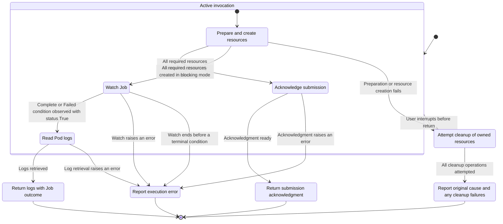

# Graceful cleanup of Kubernetes workload resources

Status: Draft

Issue: [#72](https://github.com/qubernetes-dev/q8s-kernel/issues/72)

Decision: [0006-graceful-cleanup-of-kubernetes-workload-resources.md](../adrs/0006-graceful-cleanup-of-kubernetes-workload-resources.md)

## Issue description

> - Track the Kubernetes resources created by each workload run.
> - Clean up those resources if submission fails partway through or the user interrupts the run.
> - Make cleanup safe to retry by treating missing resources as already deleted.
> - Attempt the remaining deletions if one fails, and report cleanup failures alongside the original error.
> - Keep submit-only Jobs running after acknowledgment and use the existing Kubernetes TTL to remove finished Jobs and their dependent resources.

## Scope

This specification covers resource ownership and cleanup for each `K8sContext.execute_workload()` invocation through the CLI or notebook kernel. It covers the Kubernetes Job, its Pods, the workload ConfigMap, the environment Secret, and the optional registry credentials Secret. Target plugins manage their own resources through the existing `prepare` and `cleanup` hooks. [Target plugin hooks](../../packages/q8s/src/q8s/plugins/job_template_spec.py)

## Requirements

1. Track resource ownership per invocation. Cleanup must target resources owned by that invocation. If a create request has an uncertain result, such as a connection loss after sending it, verify ownership before deleting any resource found under the requested name. A name collision must leave the existing workload and its resources intact.
2. If submission fails during preparation or resource creation, or the user interrupts execution before the invocation returns, attempt cleanup of any resources the run already created. Request cascading Job deletion so Kubernetes can remove its Pods and other Job-owned dependents. Invoke the target cleanup hook when target preparation may have created resources.
3. Treat a Kubernetes `404 Not Found` during deletion as an already-cleaned resource. A subsequent cleanup attempt must be safe if some or all resources have already been removed.
4. Attempt the remaining cleanup operations if a deletion or the target cleanup hook fails. Preserve the original submission error or interruption in the diagnostic, and report each cleanup failure alongside it. Identify the affected resource by kind, namespace, and name, or identify the failed target hook.
5. A successful submit-only invocation must acknowledge submission after creating the required resources and leave the Job running. A blocking invocation must preserve the existing `(output, stream_name)` contract and read the Pod logs for both successful and failed Jobs. Finished Jobs and their dependents remain eligible for Kubernetes TTL cleanup 100 seconds after the Job finishes. [Job configuration](../../packages/q8s/src/q8s/workload_run.py)
6. The CLI and notebook render progress from execution updates. Log ordinary renderer exceptions and continue execution or cleanup. A user interrupt from a progress callback triggers the same cleanup as an interrupt during a Kubernetes call.
7. Blocking execution treats a Job as terminal when any `Complete` or `Failed` condition has status `True`. Missing, empty, and unconfirmed conditions keep the watch open. If the watch ends first, return an explicit diagnostic on `stderr` and leave the Job in Kubernetes. If log retrieval fails after a terminal observation, report the known Job outcome and the log retrieval error on `stderr`. [Kubernetes Job status](https://kubernetes.io/docs/reference/kubernetes-api/batch/job-v1/#JobStatus)

## Proposed workload state machine

Each `execute_workload()` invocation creates a workload run. The run captures the target, image, registry credentials, and environment at the start. Its synchronous `python-statemachine` `StateChart` holds the run identity and resource records. The run records each create attempt before calling Kubernetes and adds the resource UID when Kubernetes responds. Kubernetes runs the Job and reports its status through the watch. [ADR 6](../adrs/0006-graceful-cleanup-of-kubernetes-workload-resources.md#decision)

- **Prepare and create resources.** Run target preparation, create the Job, then attach the workload ConfigMap and the required Secrets. If a create response is lost, compare the object's run annotation to the chart's run ID before using its UID for cleanup. UID preconditions protect resources that are replaced under the same name.
- **Acknowledge submission or watch the Job.** The blocking path carries the confirmed Job outcome into log retrieval. A failed Job still reaches log retrieval and returns the logs on `stderr`. A watch that ends before a terminal observation returns its diagnostic directly. Finished Jobs are eligible for TTL cleanup on both paths.
- **Attempt cleanup.** On a preparation or creation error or an interrupt, retain the original cause and attempt the applicable deletions and target cleanup. Treat `404` responses as already deleted and collect failures across the remaining operations. Report the original cause and any cleanup failures after all attempts. Kubernetes completes cascading deletion asynchronously after accepting the request.

## Acceptance scenarios

| Scenario | Expected behavior |
| --- | --- |
| Job creation succeeds and ConfigMap creation fails | Request cascading deletion of the Job and attempt applicable target cleanup. Report the ConfigMap creation error. |
| Registry Secret creation fails after the Job, ConfigMap, and environment Secret have been created | Attempt cleanup of the resources already created and report the registry Secret creation error. |
| A create request loses its connection before the response arrives | Clean up the resource if it can be verified as belonging to the run. Leave an existing resource owned by another run intact. |
| A Job name collides with an existing Job | Report the submission error and leave the existing Job and its dependents intact. |
| The user interrupts while waiting for the Job | Attempt cleanup of the run's resources and report the interruption. |
| Cleanup is repeated after some resources were removed | Treat missing resources as already deleted and attempt any remaining cleanup. |
| A deletion or target cleanup hook fails | Attempt the remaining cleanup operations, including Job deletion if it is still pending. Report the cleanup failures alongside the original error or interruption. |
| Submit-only execution succeeds | Return the submission acknowledgment without watching the Job, reading logs, or requesting deletion. |
| A watched Job finishes successfully or fails | Fetch its logs and return them with `stdout` for success or `stderr` for Job failure. Kubernetes handles eventual deletion under the configured TTL. |
| Job conditions are missing, empty, or present without a confirmed terminal condition | Continue watching until the Job reaches `Complete=True` or `Failed=True`, or the watch ends. |
| The watch ends before observing a terminal condition | Return a diagnostic on `stderr` without fetching logs or requesting deletion. |
| Pod log retrieval fails after a confirmed terminal condition | Report the confirmed outcome and the log retrieval error on `stderr`. |
| A progress renderer raises an ordinary exception | Log the renderer error and continue the workload run or cleanup. |
| The user interrupts from a progress callback | Attempt cleanup of the run's resources and report the interruption. |

## Verification and maintenance

The execution tests cover submit-only acknowledgment, terminal and incomplete Job observations, log retrieval failures, interrupted-run isolation, partial creation, lost create responses, name collisions, repeated cleanup, and diagnostics for deletion and target hook failures. Kubernetes API calls are mocked. [Execution tests](../../packages/q8s/tests/test_execution.py)

Verify cascading deletion in a Kubernetes test namespace by interrupting a running workload and checking that the Job, its Pods, the ConfigMap, and both Secrets are eventually absent when registry credentials are configured. Also verify that a submitted Job remains available after acknowledgment and that Kubernetes removes its dependents after the Job finishes and its TTL expires.
